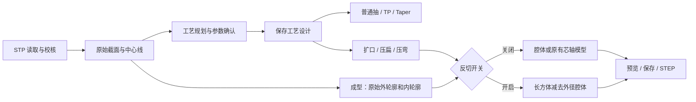

# GIANT 管件工艺软件使用说明

更新日期：2026-09-21。适用于本仓库修复后的源码版本。本次修改没有重新打包或替换安装版 EXE。

## 1. 推荐操作顺序

1. 启动软件，完成登录和已有授权检查。
2. 在模型读取页面导入 STP，等待分析完成。
3. 检查三维中心线、截面周长、壁厚曲线和测量质量提示，保存管件。
4. 在工艺规划中确认壁厚分段、工艺尺寸、抽管方式，运行优化并保存工艺设计。
5. 普通抽、TP 抽、Taper 抽和硬模成型分别加载已保存的工艺设计。
6. 在对应模块生成模型，检查预览，再保存或下载 STEP。

## 2. 导入管件与确认读取结果

- 优先使用 STP/STEP。新版直接在 CAD 曲面上求截面，显示网格仅用于预览。
- A 算法按模型主方向定位；B 算法要求管件主方向沿 Z 轴。
- 中心线采用**截面外轮廓所包围面积的形心**。它不等同于 CAD 建模时未提供的设计路径。
- 非圆截面的“等效直径”是 `外周长 / π`，不等于截面最大宽度。
- 显示壁厚为截面内外轮廓之间的最短二维距离统计；坡度很大的位置不能直接当作三维曲面法向壁厚。
- “有效测量长度”只覆盖成功读取的完整双闭环截面，不能直接当作下料全长。端部排除量会显示提示。
- 若提示待复核截面或截面缺失，先处理读取问题。优化和模具生成会拒绝使用这些未通过校核的结果。

旧版保存的数据可能缺少截面局部坐标或带有错误中心线。需要重新导入原 STP、重新保存管件，并保存关联的新工艺设计；仅重新打开旧记录不会自动修复旧测量结果。

原始测量轮廓用于成型；工程师确认的工艺周长与壁厚用于工艺计算。修改工艺曲线不会覆盖原始截面的几何轮廓。

## 3. 工艺规划、普通抽与 Taper

在工艺规划页面确认管件、抽管方式、壁厚段和长度，再运行优化。检查优化参数是否属于当前管件和当前工艺阶段，保存工艺设计。

普通抽和 Taper 模块从工艺设计数据库加载参数后，按现有流程选择机台、计算、核对参数和图号、保存或导出。此次重点修复了读取数据向 TP 和硬模的传递；没有重新验证所有机台模板或所有生产工艺公式。

## 4. TP 抽套模

1. 进入 TP 模具参数计算，选择“来自工艺设计数据库”，加载设计。
2. 确认大端内径 `T_D`、小端内径 `D` 以及 TP 段长 `T_L`。
3. 检查型线的两个原始中心线站位、段长和直径。型线表中 **X 为轴向坐标，Y 为直径**，不是半径。
4. 点击“生成套模”，查看三维模型并下载 STEP/STL。

程序按两个端点的轴向范围裁取型线，保留该段内部的局部起伏，再与固定模体外形闭合并旋转 360°。不会把整根管的型线挤入 TP 段，也不会把不匹配的设计直径悄悄换成自动猜测值。

当前沿用的模体外形为：主体外径 95 mm、法兰外径 125 mm、法兰厚度 8 mm、总长 `T_L + 27 mm`，型线小端起点为 Z=9 mm。型腔任何位置的直径必须小于 95 mm，否则需要其他规格的外形模板。

如果提示“工艺大小径不在测量型线范围内”或“段长与 T_L 不一致”，核对管件阶段、工艺参数和端点，不要继续使用错误的型线。

## 5. 硬模四个工序

先进入“硬模成型 → 加载数据”，加载关联原始管件的工艺设计，再切换到以下页面。

| 工序 | 截面与中心线的来源 | 需要检查的内容 |
| --- | --- | --- |
| 扩口 | 圆截面，半径为前序周长除以 `2π`，沿直线轴布置 | 扩口段长度、芯轴壁厚、芯轴端部长度余量 |
| 压扁 | 前序已确认的椭圆 X/Y 全轴长与周长，直中心线 | 压扁段、过渡段、总长、压扁余量 |
| 压弯 | 使用读取的中心线；圆截面或上一道压扁工序的同一组截面 | 是否先压扁，压扁参数是否继承正确 |
| 成型 | 直接使用原始外轮廓、内轮廓、位置和局部坐标系 | 来源管件、质量提示和有效长度 |

### 扩口

关闭反切时保留原有两类输出：**扩口芯轴**和**扩口腔体**。芯轴半径由圆外径减去设定壁厚，长度为扩口段长度加端部余量；腔体使用整段已确认的周长数据，代表圆形外表面所包围的实心体。

打开反切时，使用外径腔体切模体，不会用减过壁厚的芯轴去切。芯轴参数不会改变外径反切腔体。

### 压扁

轴长是**完整轴长**，例如 30×20 mm 对应半轴 15 和 10 mm。

- 两个轴长框留空：读取前序数据每个站位的 `x_length/y_length`。
- 同时填写两个轴长：作为统一截面输入，适合相应周长一致的工艺段。
- 轴长与周长必须相容，校验容差为 `max(0.05 mm, 周长×0.5%)`。
- 压扁余量作用于短轴全长，再按周长求另一轴。
- 过渡段逐渐恢复圆形，同时保持各站位的周长。
- 压扁段加过渡段不能超过总长，总长不能超过已有周长数据范围。

**当前数据限制：**旧代码中的 `x_length/y_length` 有些来自包围盒，并不必然是确认过的椭圆轴长；新版原始 STP 截面也不会自动伪造这两个工艺参数。如果记录缺少轴长或周长不相容，程序会给出明确错误。需要提供已确认轴长，不能使用旧程序固定乘 0.6 的猜测值。

### 压弯

同一工艺设计下，先成功生成压扁，再进入压弯，软件会带入压扁段、过渡段、余量和轴长设置，并开启“先执行压扁工序”。这些配置保存在当前浏览器会话中。

开启该选项后，压弯复用同一截面计算，只把截面布置到读取的中心线上；关闭时使用等周长圆截面。它不是手工输入弯曲角度的工具，目标中心线来自导入管件。

### 成型

关闭反切时输出：

- 外径形腔：原始外轮廓围成的实心包络体，可用于 CAD 布尔减。
- ~~实心内径：由原始内轮廓生成，保留原始偏心和变壁厚效果。~~
  > 2026-11-04 起「实心内径」已下线：成型页不再提供该模型与下载入口；实体化流水线也只剩外径形腔 / 扩口腔体 / 扩口芯轴 / 压扁模型 / 压弯模型 5 类。

成型不再从 STL 二次切片，不会用单个壁厚值从外轮廓反推内轮廓。

## 6. 生成反切实体模具

四个工序都有“生成反切实体模具”开关，默认关闭。

1. 打开开关，保留“自动推荐外形尺寸”。
2. 输入单侧余量，默认 15 mm。
3. 点击“生成模型”。程序按外径腔体的 XYZ 包围盒加双侧余量生成长方体，再执行 CAD 布尔减。
4. 结果显示实际 XYZ 尺寸和最小单侧余量。
5. 若要自定义尺寸，关闭自动推荐，修改 X/Y/Z 后重新生成。手动尺寸须至少在每侧留 1 mm。
6. 可开启“剖开查看内部”。此开关仅改变预览，下载的 STEP 仍是整体实体。
7. 参数改变后旧结果会标记失效；重新生成后再保存或下载。

示例：`24TK_1324-31` 推荐 `640.7 × 93.6 × 79.1 mm`，单侧余量至少 15 mm。

当前反切输出是**带封闭型腔的整体模坯**，尚未自动分模，也不含定位销、紧固孔、排气、脱模斜度或材料回弹补偿。推荐尺寸只表示几何包容与留量，未计算模具强度。后续制造设计仍应按具体机台和工艺要求完成。

## 7. 常见提示

| 提示 | 处理方式 |
| --- | --- |
| 管件测量未通过校核 | 回到读取页面检查待复核/缺失截面，不能通过调大模体绕过 |
| 缺少原始轮廓或局部坐标 | 用修复后的读取程序重新分析并保存 STP |
| 缺少已确认的椭圆轴长 | 提供两项轴长，或保存包含逐截面确认轴长的工艺记录 |
| 椭圆轴长与周长不一致 | 检查全轴/半轴、单位、工艺阶段和周长来源 |
| 模体尺寸不足 | 使用自动推荐，或增大对应 XYZ 尺寸 |
| TP 直径超出 95 mm 固定模体 | 使用适用的外形模板，当前程序会拒绝自交模体 |
| CAD 实体无效/自交 | 检查截面与中心线，不会降级导出破损三角面 STEP |

## 8. 本次验证和交付位置

- 修改原因、修复方案和测试结果：[修改说明](修改说明_2026-09-21.md)。
- 真实案例 CAD 文件：`reports/mold_validation_20260921/` 下的 `*_cavity.step`、`*_mold.step`。
- 原始读取报告仍在 `reports/stp_validation_20260921/`。
- 本次验证使用独立数据库，未替换生产数据库内容。
- 使用修复源码时需重启后端、重新构建前端；安装版 EXE 需要另外打包后才会包含这些修改。
